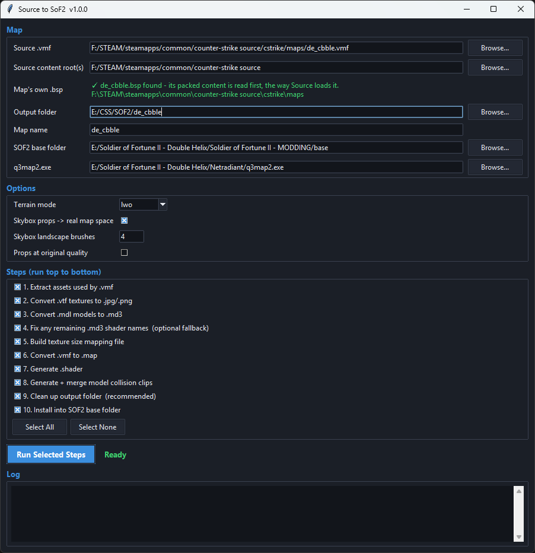

# SourceToSoF2

Converts Source engine maps (`.vmf`) into Soldier of Fortune II: Double Helix
multiplayer maps: brushwork, displacement terrain, props, decals and overlays,
textures, shaders, collision, lighting, the 3D skybox and the map's own ambient
sounds. One window, ten steps, one button.

Tested on Counter-Strike: Source maps and CS:GO maps decompiled to `.vmf`
(de_dust2, de_cache, de_overpass, de_mirage, de_cbble), for SoF2 MP 1.03.

### [Download SourceToSoF2.exe](https://github.com/KENNITHHH/SourceToSoF2/releases)

One file, nothing to install. Windows 10/11 64-bit.



---

## What you need

| | |
|---|---|
| **Windows** | 64-bit Windows 10 or 11. |
| **The map** | The map's `.vmf`. For a map you only have as `.bsp`, decompile it with [BSPSource](https://github.com/ata4/bspsrc) first. |
| **Source content** | Your Counter-Strike: Source install (or its `cstrike` folder), or folders/`.vpk` files the map's materials and models come from. If the map packs its own content into its `.bsp`, keep that `.bsp` next to the `.vmf` or under the content folder - the tool finds it and reads it first. |
| **The map's own `.bsp`** | Recommended. Besides packed content, it holds the map's **texture lights** (fluorescent tubes, light panels, lamps that glow by their texture), which exist only in the compiled `.bsp`, not in the `.vmf`. Without it, rooms lit only that way stay dark. The GUI shows whether it found one. |
| **Soldier of Fortune II** | A SoF2 install with its `base` folder. A separate copy for mapping is a good idea. |
| **q3map2** | **NetRadiant's `q3map2.exe`** (it has SoF2 support). Use this one: see below. |

You do **not** need Python or anything else installed - it is all inside the `.exe`.

---

## Quick start

1. Run `SourceToSoF2.exe`.
2. Fill in the fields:
   - **Source .vmf** - the map.
   - **Source content root(s)** - your CS:S install or extracted content (several folders: separate them with `;`).
   - **Output folder** - an empty folder; everything the tool makes goes here.
   - **Map name** - filled in from the `.vmf`.
   - **SOF2 base folder** - e.g. `...\Soldier of Fortune II - Double Helix\base`.
   - **q3map2.exe** - the q3map2 you compile with.
3. Leave all ten steps ticked and press **Run Selected Steps**.
4. When it says **Done**, open `base\maps\` and run **`compile_<map>.bat`**
   (or `compile_<map>_quick.bat` for a fast test build: less visibility culling,
   same lighting as the full build).
5. Start SoF2 and `\devmap <map>`.

The compile also writes **`<map>_release.pk3`** into your output folder: the
whole map in one file, to give to other players - they drop it into their `base`
folder. Source normal maps, ssbumps and specular/env masks are left out of it -
idTech3 has no stage that could use them - which on de_overpass saves 34 MB.

Hover over a field or a step for what it does.

---

## Which q3map2

Use **NetRadiant's** `q3map2.exe`. A converted CS map is a lot of geometry, and
NetRadiant's q3map2 grows the `.bsp` draw-vertex and draw-index lumps as needed.
Other builds - GtkRadiant 1.6.7's among them - keep those lumps in fixed arrays
of 524,288 and stop part way through `-bsp` with:

```
MAX_MAP_DRAW_INDEXES
```

The same build also stops at 8192 shaders (`MAX_SHADER_INFO exceeded`) once a
few converted maps sit in `base` side by side, though the compile works around
that one on its own.

Use a **64-bit** q3map2 as well. `-light` asks for one block of a few hundred MB
for the trace nodes (measured: 214.5 MiB on de_overpass), and a 32-bit q3map2
often cannot give it:

```
safe_malloc failed on allocation of 224919552 bytes
```

That is the address space of a 32-bit program, not your RAM.

The compile also passes `-brightness`, `-vertexscale` and `-gridscale` values
worked out for each map (see **Lighting** below). NetRadiant's q3map2 has all
three; a build without them lights the map several times too bright.

The tool checks the `q3map2.exe` you pick and says so before it runs, and the
compile `.bat` prints the same note. You can keep editing in whichever Radiant
you prefer - this is only about the build that compiles.

---

## Before you play: `com_hunkMegs`

SoF2 loads the whole `.bsp` as one block of memory, inside the 2 GB a 32-bit
game can use. A very large hunk (for example `com_hunkMegs 1024`, a common
"performance tweak") reserves half of that at startup, and a bigger map then
fails to load with:

```
Z_Malloc(): Failed to malloc ... bytes!
```

Use **`com_hunkMegs 256`** (in your config, or `+set com_hunkMegs 256` on the
`SoF2MP.exe` shortcut) and restart the game. Measured on de_overpass: the map
peaks at about 134 MB of hunk, and with 512 instead of 1024 the largest free
block went from 54 MB to 393 MB.

---

## Options

- **Terrain mode** - how displacements are built. `lwo` (default): one
  seam-free terrain model, built the way Source builds it. `patch` and `brush`
  are older modes.
- **Skybox props -> real map space** - moves 3D-skybox props to the real
  position and size they stand for. Leave on.
- **Skybox landscape brushes** - detail of the 3D-skybox landscape. Default 4.
- **Props at original quality** - off by default. Needs NetRadiant's q3map2. SoF2 has to fit the map in a
  size limit, so by default the tool simplifies props and drops small clutter
  until it fits (architecture - windows, arches, trims, doors, railings - is
  never dropped). Tick this to keep every prop at full detail and trim the map
  yourself; the log says how big the `.bsp` will get.

---

## What to expect

- **Props:** maps built mostly from props (de_cbble, for one) cannot keep every
  prop at full detail inside SoF2's limits. Expect simplified props and missing
  small clutter (cans, bottles, tools) on those. The step 6 log lists exactly
  what was simplified and what was dropped.
- **Sounds:** each map's own CS soundscape sounds, as SoF2 speakers. Random
  background sounds beyond 32 speakers are left out (each speaker costs one of
  the entities SoF2 sends to every player).
- **Prop skins:** a Source prop placed with a skin other than the first one is
  converted with skin 0. Mostly this shows on foliage and light fixtures, where
  Valve used skins for colour variants. The step 10 audit lists every prop it
  affects.
- **Game logic:** Source's entity I/O (buttons, triggers, timers wired to each
  other) has no SoF2 equivalent and is not converted. Bomb sites and buy zones
  are not converted either.
- **Lighting:** matched to the lighting Valve baked into the CS:S map, from
  the map's own `light_environment` and lights, and from its texture lights when
  the `.bsp` is there. Measured against Valve's lightmaps, de_dust2 comes out at
  1.00 in sunlight, shade and lamp-lit areas. Two things CS:S does on top are
  not reproduced: its HDR tonemapping and bloom, which make sunlight look a
  little punchier with HDR on (`mat_hdr_level 0` in CS:S shows the look that is
  matched), and per-pixel bump/specular. Compiles take longer than a plain
  q3map2 compile: q3map2 normally cuts dim light off at its edges, and the
  converted map is set up so that it does not (de_dust2: 484 s -> 666 s on 16
  threads). The bounce pass of big prop-heavy maps takes longest.
- **Several converted maps side by side:** shaders for shared CS textures come
  out identical from every map, so one map cannot spoil another's look.

---

## When something goes wrong

Your output folder also gets **`_missing_assets.txt`**: what the map referred to
and step 2 could not find. It separates the few files a conversion would have
used from the Source model and per-pixel-lighting files it never needs, so a
long list there is normal.

Every run writes **`SourceToSoF2.txt`** next to the `.exe`: the full log of all
ten steps. When you report a problem, attach that file, plus the compile
window's output if it was the compile that failed.

- **Z_Malloc error in game** - see `com_hunkMegs` above.
- **"MAX_MAP_DRAW_INDEXES" in the compile** - the q3map2 you used keeps the
  `.bsp` draw lumps in fixed arrays. Use NetRadiant's q3map2 (see above). If you
  have to use another build, convert again without **Props at original quality**
  so there is less geometry.
- **"safe_malloc failed on allocation of ... bytes"** - your q3map2 is 32-bit.
  Use a 64-bit one (see above).
- **The map is lit several times too bright, or the .bat warns that q3map2
  "does not know -brightness"** - the q3map2 you used is not NetRadiant's. Use
  NetRadiant's q3map2 (see above).
- **A room that is lit in CS:S is dark** - check the GUI found the map's own
  `.bsp` (the "Map's own .bsp" line): rooms lit by glowing textures need it.
  Then run the steps again.
- **The compile .bat cannot find q3map2** - set the `q3map2.exe` field and run
  step 10 again, or edit the `Q3MAP2` line at the top of the `.bat`.
- **"MAX_SHADER_INFO exceeded" in the compile** - q3map2 can load 8192 shaders
  and each converted map adds 700-1500, so the compile leaves the other
  converted maps' shader files out of `shaderlist.txt` while it runs and puts
  the list back afterwards. It prints what it left out and roughly how many
  shaders are left. If it still stops, your `base` holds a lot of other custom
  shaders: move the unused loose `.shader` files out of `base\shaders`.
- **"SourceToSoF2.exe was not found" from the .bat** - the compile runs some
  helpers through `SourceToSoF2.exe`; if you moved it, run step 10 again.
- **Windows Defender / antivirus warns about the .exe** - single-file programs
  packed with PyInstaller are sometimes flagged by mistake. The program only
  reads your source files and writes into the output and SoF2 `base` folders.

---

## Reporting issues

Open an issue on this repository's **Issues** tab: the map, what you saw
(a screenshot and the in-game `viewpos` help a lot), and `SourceToSoF2.txt`.

---

## Content and legal

SourceToSoF2 is a converter. The maps, models, textures and sounds it converts
belong to their owners (for Counter-Strike content, Valve Corporation), and
converting them does not change that. Share converted maps only where you have
the right to. This project is not affiliated with Valve, Raven Software or
Activision.

## License

The tool is released under the MIT License - see [LICENSE](LICENSE).

The `.exe` carries a Python interpreter, NumPy and Pillow inside it; their
licenses are listed in [THIRD-PARTY-NOTICES.md](THIRD-PARTY-NOTICES.md).

Made by **KENNITHH**.
